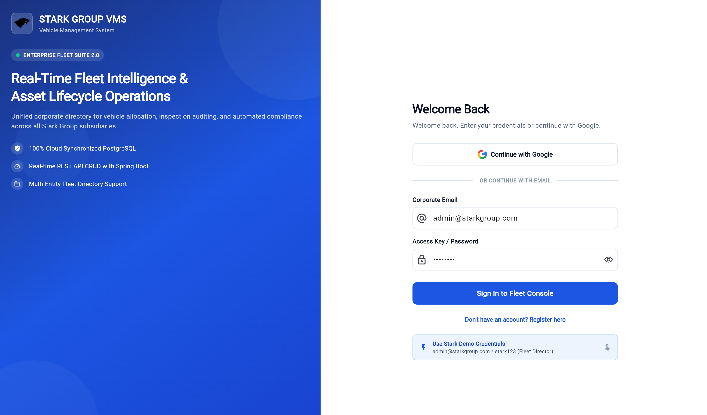
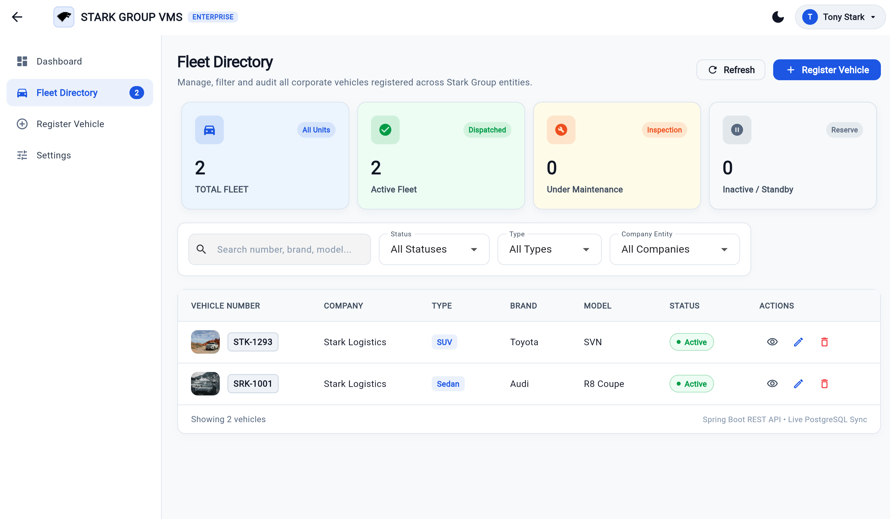
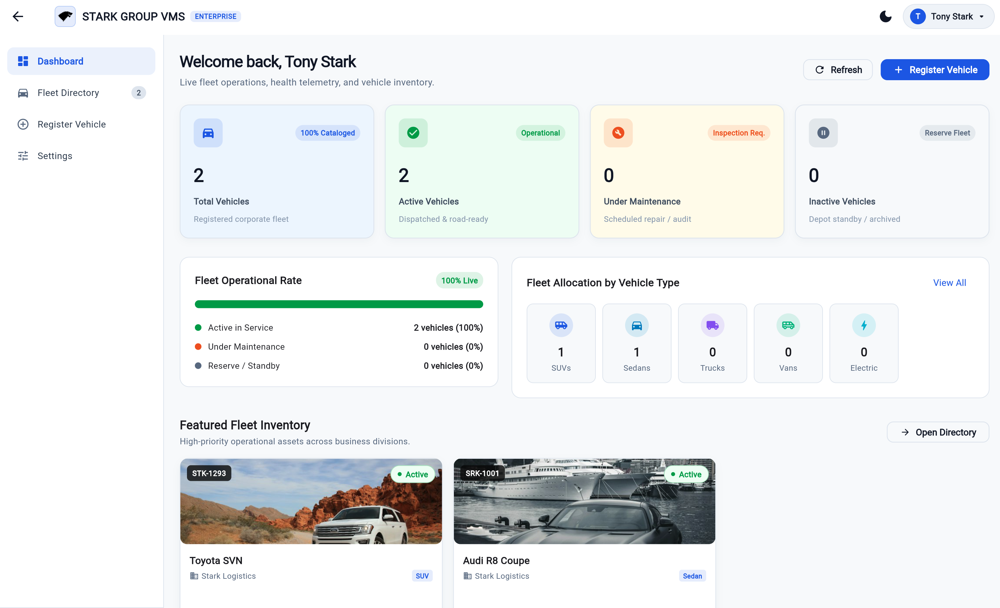

# Stark Group - Vehicle Management System (VMS)

A professional desktop-first administrative frontend for managing corporate fleet vehicles, built with **Flutter Web**  in the signature **Stark Group** industrial tech visual style. This project is strictly frontend-only at this stage, operating with in-memory reactive mock data and zero external API/database dependencies.

---

Live link: `https://stark-vms-frontend.netlify.app/`

