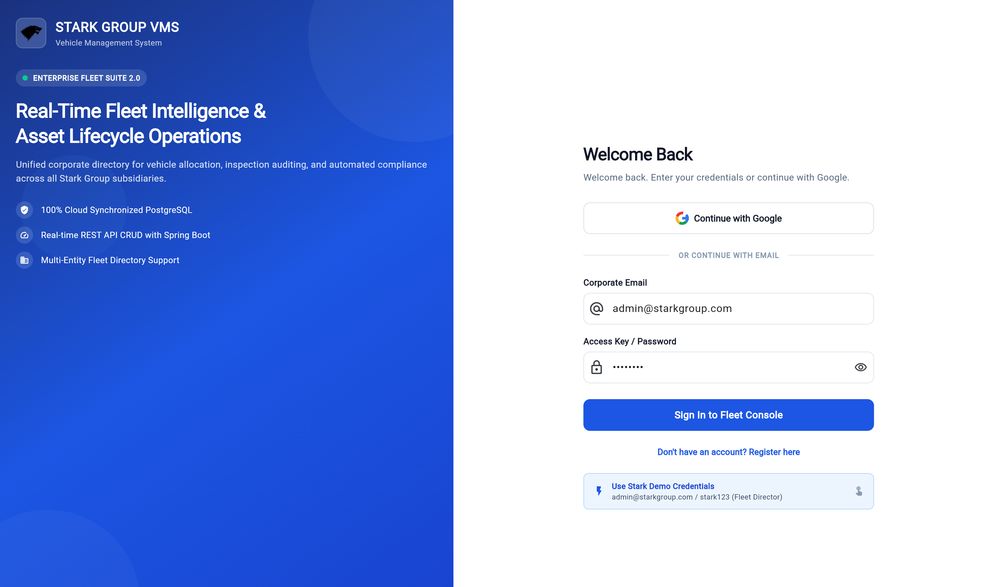
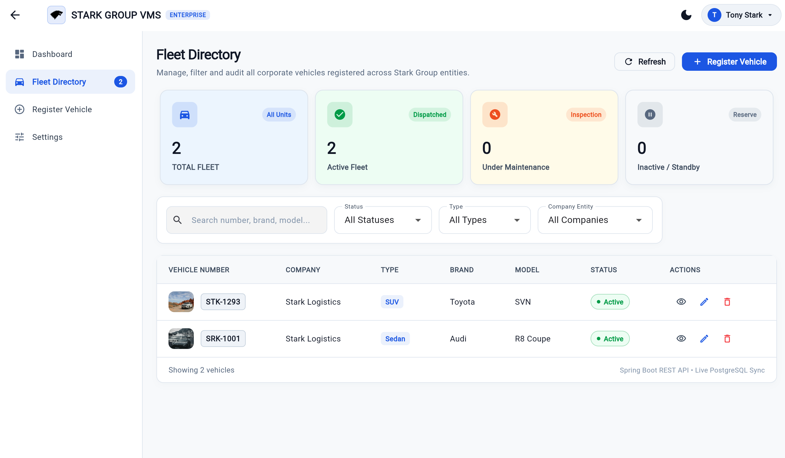
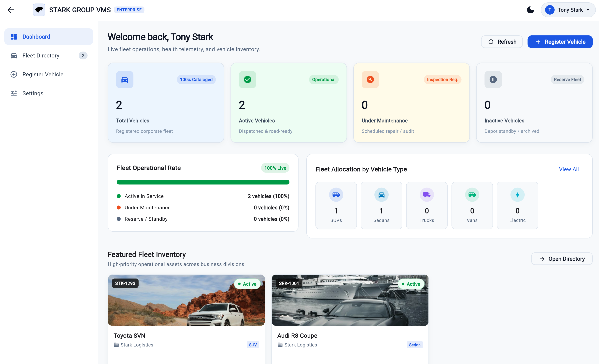

# Stark Fleet

A Flutter Web SaaS application for managing vehicles in workspace-scoped fleets. It includes Supabase email authentication, Google OAuth integration, vehicle create/edit/delete flows, workspace billing UI, and a responsive marketing site.

## Run locally

Copy `.env.example` to `.env.local`, fill in your Supabase project URL and publishable key, then run `./run-web.sh`. Start the API separately from the backend repo.

The launcher passes configuration as Flutter Dart defines; plain `flutter run` does not load `.env.local`.

## Deploy to Vercel

Import this repository and use the default repository root. `vercel.json` runs `vercel-build.sh` and serves `build/web`. Set these Vercel environment variables:

- `API_BASE_URL`: deployed Spring API origin.
- `SUPABASE_URL`: Supabase project URL.
- `SUPABASE_ANON_KEY`: Supabase publishable key.

`NEXT_PUBLIC_SUPABASE_URL` and `NEXT_PUBLIC_SUPABASE_PUBLISHABLE_KEY` are also accepted. See [DEPLOYMENT.md](DEPLOYMENT.md) for Supabase redirect and Vercel setup.

